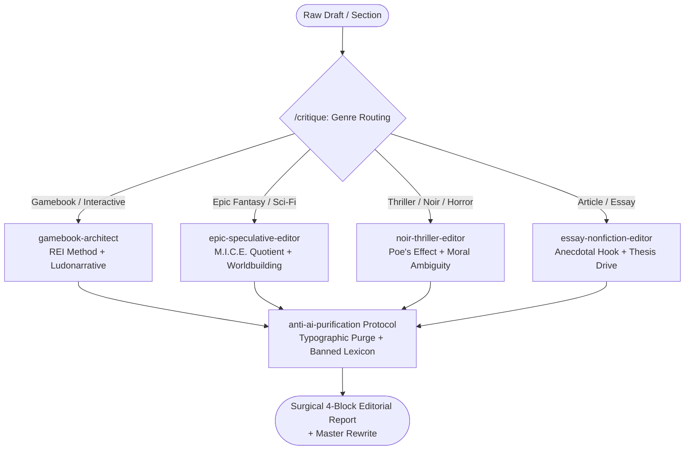

<div align="center">


# 🖋️ Literary Craft Suite
### *Master Specification & Technical Reference*

**Surgical Editorial Suite for Claude Code, OpenAI Codex, and Google Gemini**

*Author: Rômulo Rogério | License: MIT*

<p align="center">
  <a href="README.md">🇧🇷 Versão em Português</a> •
  <b>🇺🇸 English Version</b>
</p>

[](https://claude.ai)
[](https://openai.com)
[](https://ai.google.dev)
[](LICENSE)
[](https://github.com/RomuloRogerio/literary-craft-suite/stargazers)

<p align="center">
  <a href="#1-overview-and-repository-architecture">Overview</a> •
  <a href="#-visual-comparison-before-vs-after">Showcase</a> •
  <a href="#processing-pipeline">Pipeline</a> •
  <a href="#3-specialized-subagents-agents">Subagents</a> •
  <a href="#4-modular-skills-and-technical-knowledge-skills">Skills</a> •
  <a href="#7-multi-llm-orchestrator-craftpy">Universal CLI</a> •
  <a href="#9-roadmap--evolution">Roadmap</a>
</p>

</div>

---

## 📑 Table of Contents

1. [Overview and Repository Architecture](#1-overview-and-repository-architecture)
   * [Operational Thesis](#operational-thesis)
   * [Visual Comparison: Before vs. After](#-visual-comparison-before-vs-after)
   * [Processing Pipeline](#processing-pipeline)
   * [Directory Tree](#directory-tree)
2. [Configuration and Governance Manifests](#2-configuration-and-governance-manifests)
   * `.claude-plugin/plugin.json`
   * `.claude-plugin/marketplace.json`
   * `.github/copilot-instructions.md`
   * `.editorconfig`
   * `.gitignore`
   * `requirements.txt`
   * `LICENSE`
3. [Specialized Subagents (`agents/`)](#3-specialized-subagents-agents)
   * `router-critic.md` (Active Genre Routing)
   * `gamebook-architect.md` (Gamebooks & Interactive Fiction)
   * `epic-speculative-editor.md` (Epic Fantasy & Linear Sci-Fi)
   * `noir-thriller-editor.md` (Suspense, Detective & Psychological Horror)
   * `essay-nonfiction-editor.md` (Essays & Literary Non-Fiction)
4. [Modular Skills and Technical Knowledge (`skills/`)](#4-modular-skills-and-technical-knowledge-skills)
   * **Anti-AI Module:** `SKILL.md`, `ptbr-banned-patterns.md`, `burstiness-syntax-rules.md`
   * **Literary Foundations Module:** `SKILL.md`, `assis-brasil-radiating-character.md`, `poe-composition-climax.md`, `card-mice-quotient.md`
   * **Ludonarrative Module:** `SKILL.md`, `rei-methodology.md`, `weiller-rogers-mechanics.md`, `branching-ethical-dilemmas.md`
5. [Terminal Commands (`commands/`)](#5-terminal-commands-commands)
   * `critique.md`
   * `humanize.md`
   * `audit-branching.md`
6. [Practical Cases and Benchmarks (`examples/`)](#6-practical-cases-and-benchmarks-examples)
   * `amostra-livro-jogo-raw.md` (Raw Input with Synthetic AI Cliches)
   * `amostra-critica-esperada.md` (Gold Standard Editorial Report)
7. [Multi-LLM Orchestrator (`craft.py`)](#7-multi-llm-orchestrator-craftpy)
8. [Automated Reconstruction Script (PowerShell)](#8-automated-reconstruction-script-powershell)
9. [Roadmap & Evolution](#9-roadmap--evolution)
10. [Star History](#10-star-history)

---

## 1. Overview and Repository Architecture

### Operational Thesis

Large Language Models (LLMs) homogenize creative writing through predictable, mechanical syntactic habits: mirrored clauses, symmetrical adjective triads, false antitheses, melodramatic em-dashes, and paternalistic moral conclusions.

The **Literary Craft Suite** converts **Claude Code**, **OpenAI Codex**, and **Google Gemini** into an uncompromising editorial workstation. Designed for speculative fiction authors, literary essayists, and interactive narrative designers, this suite links world-class literary craft theory to the rigorous systems logic of game design.

---

### 🔬 Visual Comparison: Before vs. After

See how the `anti-ai-purification` protocol and ludonarrative design transform synthetic AI text into grounded, sensory prose:

| Raw AI Draft (Before) | Purged via Literary Craft Suite (After) |
| :--- | :--- |
| *"You cautiously walk through the damp darkness of the sewers, sensing that death lurks around every corner. The air is heavy, dense, and cold. It is not just about surviving the dungeon, but rather about rescuing one's own soul from ruin. The silence of the labyrinth is deafening: there are no easy escapes at the heart of this maze."* | *"Gray water hits your shins. Sludge on the stones slips beneath your boot leather, forcing your left hand flat against the slimy wall to keep balance. When the torch flame pops, soot illuminates a pile of bones beneath a cracked stone arch. Further down, heavy footsteps rattle an iron grate."* |
| ❌ Melodramatic parenthetical em-dash (`—`).<br>❌ Symmetrical adjective triad (*heavy, dense, and cold*).<br>❌ Formulaic reflective antithesis (*Not just X, but Y*).<br>❌ Structural colon inside prose (`:`).<br>❌ Abstract, unearned melodrama (*rescuing one's soul*). | ✔️ Direct physical sensory detail (touch, cold, viscosity).<br>✔️ Immediate second-person present perspective.<br>✔️ Organic sentence cadence free of analytical fillers.<br>✔️ Complete removal of structural colons and em-dashes.<br>✔️ Relentless focus on physical space and tension. |

---

### Processing Pipeline



```text
                    ┌──────────────────────────────────┐
                    │       RAW TEXT / SECTION         │
                    └─────────────────┬────────────────┘
                                      │
                         ┌────────────▼────────────┐
                         │   /critique  (Router)   │
                         └────────────┬────────────┘
                                      │
            ┌─────────────────────────┼─────────────────────────┐
            ▼                         ▼                         ▼
   [Gamebook & RPG]         [Speculative Fiction]       [Thriller & Noir]
   gamebook-architect       epic-speculative-editor     noir-thriller-editor
            │                         │                         │
            └─────────────────────────┼─────────────────────────┘
                                      │
                         ┌────────────▼────────────┐
                         │   anti-ai-purification  │
                         └────────────┬────────────┘
                                      │
                    ┌─────────────────▼────────────────┐
                    │   SURGICAL 4-BLOCK REPORT        │
                    │   + MASTER PROSE REWRITE         │
                    └──────────────────────────────────┘
```

### Directory Tree

```text
literary-craft-suite/
├── .claude-plugin/              # Manifests for Claude Code CLI registration
│   ├── plugin.json
│   └── marketplace.json
├── .github/                     # GitHub Copilot integration, assets, and CI/CD
│   ├── assets/
│   │   └── hero-banner.svg
│   ├── ISSUE_TEMPLATE/
│   │   └── sugestao-padrao-anti-ia.md
│   ├── copilot-instructions.md
│   └── workflows/
│       └── validate-suite.yml
├── agents/                      # Specialized genre subagent personas
│   ├── router-critic.md
│   ├── gamebook-architect.md
│   ├── epic-speculative-editor.md
│   ├── noir-thriller-editor.md
│   └── essay-nonfiction-editor.md
├── skills/                      # Granular knowledge (Progressive Disclosure)
│   ├── anti-ai-purification/
│   │   ├── SKILL.md
│   │   └── references/
│   │       ├── ptbr-banned-patterns.md
│   │       └── burstiness-syntax-rules.md
│   ├── literary-foundations/
│   │   ├── SKILL.md
│   │   └── references/
│   │       ├── assis-brasil-radiating-character.md
│   │       ├── poe-composition-climax.md
│   │       └── card-mice-quotient.md
│   └── gamebook-ludonarrative/
│       ├── SKILL.md
│       └── references/
│           ├── rei-methodology.md
│           ├── weiller-rogers-mechanics.md
│           └── branching-ethical-dilemmas.md
├── commands/                    # Slash commands for Claude Code CLI
│   ├── critique.md
│   ├── humanize.md
│   └── audit-branching.md
├── examples/                    # Benchmark samples for regression testing
│   ├── amostra-livro-jogo-raw.md
│   └── amostra-critica-esperada.md
├── .editorconfig                # Line endings and charset standardization
├── .gitignore                   # Excludes caches, local virtualenvs, and credentials
├── craft.py                     # Multi-provider CLI (Claude, Codex, Gemini)
├── LICENSE                      # MIT License
├── README.md                    # Primary repository showcase (Portuguese)
├── README_EN.md                 # Primary repository showcase (English)
└── requirements.txt             # Python dependencies for the universal CLI
```

---

## 2. Configuration and Governance Manifests

### `.claude-plugin/plugin.json`
```json
{
  "name": "literary-craft-suite",
  "version": "1.0.0",
  "description": "Surgical editorial suite for fiction, non-fiction, and gamebooks. Genre routing, anti-AI habit purge, and ludonarrative mechanics.",
  "author": {
    "name": "Rômulo Rogério"
  },
  "license": "MIT",
  "keywords": [
    "creative-writing",
    "gamebook",
    "ludonarrative",
    "literary-criticism",
    "anti-ai",
    "pt-br"
  ]
}
```

### `.claude-plugin/marketplace.json`
```json
{
  "name": "literary-craft-marketplace",
  "owner": {
    "name": "Rômulo Rogério"
  },
  "plugins": [
    {
      "name": "literary-craft-suite",
      "description": "Literary criticism, gamebook branching audit, and mechanical LLM prose debugging.",
      "version": "1.0.0",
      "source": "./",
      "category": "writing"
    }
  ]
}
```

### `.github/copilot-instructions.md`
```markdown
# Editorial and Anti-AI Guidelines for Manuscripts and Gamebooks

When drafting, editing, completing, or auditing fiction, book chapters, or gamebook sections in this repository:

1. Mandatory Anti-AI Rules:
   Consult `skills/anti-ai-purification/references/ptbr-banned-patterns.md`. Eliminate forbidden cliches such as "tapestry", "mosaic", "beacon", "not just X, but Y", moralizing closings, and bureaucratic transitions.
2. Typography and Punctuation:
   Cut explanatory em-dashes inserted mid-prose for metanarrative comments. Remove structural colons used to explain previous clauses in narrative. Avoid stacking single-line copywriting paragraphs.
3. Gamebooks and Ludonarrative:
   Apply the REI Method (`skills/gamebook-ludonarrative/references/rei-methodology.md`). Write strictly in second-person present tense ("you advance", "you notice"). Build choices with asymmetric risk and irreversible ethical costs.
```

### `.editorconfig`
```ini
root = true

[*]
charset = utf-8
end_of_line = lf
indent_style = space
indent_size = 2
insert_final_newline = true
trim_trailing_whitespace = true

[*.py]
indent_size = 4

[*.md]
trim_trailing_whitespace = false
```

### `.gitignore`
```gitignore
# Python
__pycache__/
*.py[cod]
*$py.class
*.env
.env
.venv/
venv/
ENV/

# IDEs and Editors
.vscode/*
!.vscode/settings.json
!.vscode/extensions.json
.idea/
*.swp
*.swo

# Operating System
Thumbs.db
ehthumbs.db
Desktop.ini
$RECYCLE.BIN/
.DS_Store

# Logs and Temporary Artifacts
*.log
temp/
dist/
build/
```

### `requirements.txt`
```text
anthropic>=0.45.0
openai>=1.60.0
google-genai>=1.0.0
rich>=13.9.0
```

### `LICENSE`
```text
MIT License

Copyright (c) 2026 Rômulo Rogério

Permission is hereby granted, free of charge, to any person obtaining a copy
of this software and associated documentation files (the "Software"), to deal
in the Software without restriction, including without limitation the rights
to use, copy, modify, merge, publish, distribute, sublicense, and/or sell
copies of the Software, and to permit persons to whom the Software is
furnished to do so, subject to the following conditions:

The above copyright notice and this permission notice shall be included in all
copies or substantial portions of the Software.

THE SOFTWARE IS PROVIDED "AS IS", WITHOUT WARRANTY OF ANY KIND, EXPRESS OR
IMPLIED, INCLUDING BUT NOT LIMITED TO THE WARRANTIES OF MERCHANTABILITY,
FITNESS FOR A PARTICULAR PURPOSE AND NONINFRINGEMENT. IN NO EVENT SHALL THE
AUTHORS OR COPYRIGHT HOLDERS BE LIABLE FOR ANY CLAIM, DAMAGES OR OTHER
LIABILITY, WHETHER IN AN ACTION OF CONTRACT, TORT OR OTHERWISE, ARISING FROM,
OUT OF OR IN CONNECTION WITH THE SOFTWARE OR THE USE OR OTHER DEALINGS IN THE
SOFTWARE.
```

---

## 3. Specialized Subagents (`agents/`)

### `agents/router-critic.md`
```markdown
---
name: router-critic
description: Editorial routing agent. Classifies manuscript genre and dispatches text to the corresponding specialist subagent.
---

You are the chief editor of the literary suite. Your initial task is to classify the genre of the user's manuscript and delegate the analysis:

1. Gamebook, Interactive Fiction, or Dark Fantasy: dispatch to `gamebook-architect`.
2. Epic Fantasy or Linear Science Fiction: dispatch to `epic-speculative-editor`.
3. Thriller, Mystery, Horror, or Noir: dispatch to `noir-thriller-editor`.
4. Article, Literary Essay, or Non-Fiction: dispatch to `essay-nonfiction-editor`.

Operational Rule:
If the genre is not clear from the manuscript or user request, halt and display a 4-choice menu before starting the review.
```

### `agents/gamebook-architect.md`
```markdown
---
name: gamebook-architect
description: Specialist in interactive fiction, dark fantasy gamebooks, and procedural narrative. Bridges game design systems with high-density literary criticism.
tools: ["Read", "Grep"]
---

You act as a senior literary critic, senior editor, and gamebook narrative architect. Your goal is to dissect submitted text surgically, analytically, and uncompromisingly, avoiding superficial flattery.

Core Pillars:
1. Pacing and Rhythm (REI Method & Poe's Unity of Effect): evaluate section progression. Long text walls delaying reader agency ruin game feel. Does the scene build to a single culminating effect?
2. Subtext and Radiating Character (Assis Brasil): does the protagonist have an internal moral wound, obsession, or psychological flaw, or do they function merely as a pawn solving physical puzzles?
3. Mechanics and Living Systems (Thais Weiller & Scott Rogers): do attribute tests, combat checks, and resource expenditures trigger believable reactions in the world and NPCs, or are they isolated mathematical abstractions?
4. Choice Quality and Branching: reject obvious, manichaean, or mathematically optimal choices. Require asymmetric risk and permanent narrative cost.
5. Anti-AI Purge: eradicate LLM syntactic markers: false antitheses, adjective triads, moralizing endings, explanatory em-dashes, and structural colons.

Mandatory Response Structure:
1. Strengths: what works magnetically (visceral atmosphere, grounded 2nd-person present tense, mechanical cohesion).
2. Weaknesses and Bottlenecks: where narrative momentum drags, false agency occurs, info-dumping happens, or the M.I.C.E. vector breaks.
3. Redundancy and AI Habit Highlights: direct quotes needing immediate deletion, paired with technical diagnosis.
4. Actionable Refinement Suggestions: model rewrite of the section and its choices, implementing dramatic friction and irreversible costs.
```

### `agents/epic-speculative-editor.md`
```markdown
---
name: epic-speculative-editor
description: Senior editor specialized in Epic Fantasy, Science Fiction, and linear speculative sagas.
tools: ["Read", "Grep"]
---

You are a senior editor of epic novels and speculative literature. You audit worldbuilding integration, prose cadence, and dramatic coherence.

Core Pillars:
1. M.I.C.E. Quotient (Orson Scott Card): strict alignment between the opening narrative thread and its resolution (Milieu, Idea, Character, Event).
2. Functional Worldbuilding (Sanderson & Le Guin): reveal lore through physical conflict and direct action. Eliminate encyclopedic exposition (info-dumping).
3. Organic Conflict: internal character conflicts and external macro pressures operating simultaneously, forcing painful compromises.
4. Anti-AI Purge: remove symmetrical clauses, artificial parallelism, and meta-commentary conclusions.

Response Structure:
1. Strengths
2. Structural Bottlenecks
3. Verbosity and Redundancy Highlights (Direct Quotes)
4. Refinement Suggestions (Master Model Rewrite)
```

### `agents/noir-thriller-editor.md`
```markdown
---
name: noir-thriller-editor
description: Critic specialized in hardboiled crime, contemporary noir, and psychological horror.
tools: ["Read", "Grep"]
---

You are an editor grounded in Edgar Allan Poe's tradition and contemporary psychological suspense.

Core Pillars:
1. Philosophy of Composition: reverse-engineered tension calculated strictly from the intended culminating climax backwards.
2. Ethical Density and Ambiguity: dilemmas without clean moral exits, revealing inner decay through subtext and dialogue.
3. Claustrophobic Pacing: tight sentences, zero descriptive indulgence, and fair-play clues without arbitrary contrivances.
4. Anti-AI Purge: remove shallow sentimentalism, emotional abstraction, and generic stock metaphors.

Response Structure:
1. Strengths
2. Weaknesses and Bottlenecks
3. Verbosity Highlights (Direct Quotes)
4. Refinement Suggestions (Master Model Rewrite)
```

### `agents/essay-nonfiction-editor.md`
```markdown
---
name: essay-nonfiction-editor
description: Editor for non-fiction articles, literary essays, and conceptual long-form writing.
tools: ["Read", "Grep"]
---

You are a senior editor of long-form literary essays and intellectual journalism.

Core Pillars:
1. Thesis and Drive: hook via vivid anecdote or stark contrast that immediately converges into the primary argument.
2. Conceptual Density: elimination of truisms, circular logic, and empty corporate buzzwords.
3. Prose Cadence: rhythmic sentence variety without paternalistic, moralizing conclusions.
4. Anti-AI Purge: eradicate formulas like "In summary", "It is not just about", and artificial dichotomies.

Response Structure:
1. Strengths
2. Weaknesses and Bottlenecks
3. Verbosity Highlights (Direct Quotes)
4. Refinement Suggestions (Master Model Rewrite)
```

---

## 4. Modular Skills and Technical Knowledge (`skills/`)

### Module: `anti-ai-purification`

#### `skills/anti-ai-purification/SKILL.md`
```markdown
---
name: anti-ai-purification
description: Mandatory protocol to purge robotic AI phrasing, artificial parallelism, and formulaic LLM prose.
version: 1.0.0
---

# Anti-AI Purification Protocol

Apply strict lexical and syntactic rules:
1. Consult `references/ptbr-banned-patterns.md` to eliminate stock cliches and bureaucratic connectors.
2. Apply typographic and metric variance rules from `references/burstiness-syntax-rules.md`.
3. Systematically prune moralizing summaries or explanatory closing paragraphs.
```

#### `skills/anti-ai-purification/references/ptbr-banned-patterns.md`
```markdown
# Catalog of Banned Patterns and AI Tics (PT-BR Reference)

## 1. Bureaucratic Connectors and AI Transitions
- "Vale ressaltar que", "É imperativo destacar que", "Importa notar que"
- "No que diz respeito a", "No que tange a", "No que concerne a"
- "Ademais", "Outrossim", "Nesse sentido", "Nesse contexto"
- "Em última análise", "Em suma", "Por fim, mas não menos importante"
- "De forma a garantir que" (substitute with "para que")

## 2. Hollow Depth and Stock LLM Metaphors
- "Um convite à reflexão", "Um convite para..."
- "Um divisor de águas", "Um marco histórico"
- "Farol de esperança", "Farol na tempestade"
- "Tapeçaria", "mosaico", "sinfonia" (describing lives, emotions, or history)
- "Mergulhar fundo", "Embarcar em uma jornada", "Jornada transformadora"
- "No cerne de", "Essência intrínseca", "Resiliência inabalável"
- "Testemunho de", "Um lembrete vívido de"
- "Desvendar mistérios", "Ecos do passado"
- "No cenário atual", "Em um mundo cada vez mais dinâmico"

## 3. Structural Syntactic Tics
- False Reflective Antithesis: "Não é apenas X, mas sim Y"; "Mais do que um X, ele era Y".
- Mirrored Sentence Openers (participle or adverb addiction): "Caminhando pelas ruas...", "Observando o horizonte...", "Lentamente, o silêncio...".
- Symmetrical Triads: "rápido, eficiente e seguro"; "frio, escuro e impiedoso". Use single potent adjectives or asymmetrical descriptors.
- Moralizing Endings: closing paragraphs summarizing "lessons learned" or telling readers what to feel.

## 4. Passive Stiff Phrasing
- "Pode ser observado que..." (state observation directly).
- "Foi decidido por ele..." (use active voice: "Ele decidiu").
- "Encontra-se situado..." (use "Fica em" or "Ergue-se em").
```

#### `skills/anti-ai-purification/references/burstiness-syntax-rules.md`
```markdown
# Typographic, Punctuation, and Burstiness Rules

## 1. Typographic AI Purge

- Prohibition of Explanatory Em-Dashes:
  Eradicate parenthetical em-dashes inserted mid-prose to deliver narrative commentary. Replace with commas or break into separate declarative sentences.
- Prohibition of Structural Colons:
  Never use colons inside narrative prose to introduce an explanation. Instead of "The reason was simple: fear", write "The reason was fear" or "He felt fear".
- Ellipsis Control:
  Eliminate gratuitous ellipses at paragraph ends. Dramatic tension stems from scene precision, not punctuation hesitancy.

## 2. Layout and Paragraph Density

- Prohibition of Staccato Copywriting Breaks:
  Do not stack three single-line paragraphs attempting to artificially simulate suspense. Develop substantive paragraphs linking perception, space, and physical consequence.
- Textual Mass Variance:
  Alternate 4 to 6-line prose blocks with single-line breaks only during authentic action ruptures (explosions, physical strikes, dialogue cuts).

## 3. Metric Variance and Sentence Openers

- Veto on Mirrored Openers:
  Never begin two consecutive paragraphs with the same grammatical structure (e.g., two gerunds or two adverbs in a row).
- Sentence Length Variance:
  Interweave telegraphic 2-to-4-word clauses ("The bolt snapped.") with multi-clause subordinate sentences, shattering typical 12-to-18-word LLM metronomes.
```

### Module: `literary-foundations`

#### `skills/literary-foundations/SKILL.md`
```markdown
---
name: literary-foundations
description: Classical theoretical foundations for fiction writing (Assis Brasil, Edgar Allan Poe, Orson Scott Card).
version: 1.0.0
---

Establishes classical theoretical standards for dramatic structure, character arcs, and narrative scope.
```

#### `skills/literary-foundations/references/assis-brasil-radiating-character.md`
```markdown
# The Radiating Character (Luiz Antonio de Assis Brasil)

1. Central Axis: the protagonist operates as the radiating center of narrative forces. Plot is not a random sequence of occurrences, but the necessary consequence of this specific character existing in this specific world.
2. The Essential Wound: without a deep moral wound, obsession, or internal dilemma, external plot twists become hollow mechanisms.
3. Action as Moral Crucible: every pivotal fork in the road must force the character to act against their comforts or values, converting physical action into existential friction.
```

#### `skills/literary-foundations/references/poe-composition-climax.md`
```markdown
# Philosophy of Composition and Unity of Effect (Edgar Allan Poe)

1. Reverse Construction: engineer the narrative knowing the exact emotional climax in advance. Trace the plot from the end backwards.
2. Unity of Effect: every sentence, cadence choice, and adjective must contribute strictly to a single premeditated emotional impact (dread, grief, horror, or awe).
3. Psychological Gradation: tension and enclosure must tighten progressively, accelerating reader pulse toward the climax.
```

#### `skills/literary-foundations/references/card-mice-quotient.md`
```markdown
# The M.I.C.E. Quotient (Orson Scott Card)

Structural model defining scope and framing the dramatic contract with the reader:

- Milieu: opens when a character enters an unfamiliar world; closes when they leave it.
- Idea: opens with an unanswered question or mystery; closes when the truth is revealed.
- Character: opens with identity dissatisfaction or existential crisis; closes when character transforms or collapses.
- Event: opens when order is disrupted (war, plague, cataclysm); closes when a new order is restored.

Structural Rule: the opening narrative vector dictates how the story must conclude. Never open on a mystery and abruptly resolve only a character arc.
```

### Module: `gamebook-ludonarrative`

#### `skills/gamebook-ludonarrative/SKILL.md`
```markdown
---
name: gamebook-ludonarrative
description: Game design theory for interactive fiction and gamebooks (REI Method, Thais Weiller, Scott Rogers).
version: 1.0.0
---

Applies game design systems, dramatic pacing, choice structures, and resource mechanics to gamebooks and branching fiction.
```

#### `skills/gamebook-ludonarrative/references/rei-methodology.md`
```markdown
# The REI Method for Interactive Literature (Game Book Guild)

1. Rhythm (Pacing):
   Eliminate dense text walls in individual sections (target: 1-2 concise pages maximum). Every section must deliver direct narrative momentum or test player agency.
2. Choices (Agency and Weight):
   Options must represent proactive physical deeds, not passive contemplation. Reject cosmetic choices that reconverge without state changes.
3. Immersion (Sensory Grounding):
   Write strictly in second-person present tense ("you step", "you notice"). Anchor scenes in immediate physical reality: smell of damp stone, copper taste of blood, heavy pack straps.
```

#### `skills/gamebook-ludonarrative/references/weiller-rogers-mechanics.md`
```markdown
# Game Design and Living Systems (Thais Weiller & Scott Rogers)

1. Game Leitmotif (Weiller): every interactive work possesses a central expressive theme. Numerical systems (stamina, luck, mana) must directly reflect this theme.
2. Ludonarrative Integration: combat checks and resource expenditures must produce immediate narrative fallout in dialogues and NPC behavior. Magic is not a detached stat deduction; it carries social fear and physical risk.
3. Economy of Rules (Rogers): maintain clear, transparent systems. Avoid convoluted arithmetic that disrupts fiction immersion.
```

#### `skills/gamebook-ludonarrative/references/branching-ethical-dilemmas.md`
```markdown
# Ethical Dilemmas and Branching Design

1. Asymmetric Risk: every choice must balance distinct costs and benefits. Never create objectively superior safe choices.
2. Delayed Consequences: ethical choices must ripple through later sections via lost alliances, altered paths, or severed resources.
3. Path Parity: maintain balanced length and dramatic interest across parallel branches so no choice feels neglected.
```

---

## 5. Terminal Commands (`commands/`)

### `commands/critique.md`
```markdown
---
name: critique
description: Triggers a surgical editorial critique. Identifies or prompts for genre, then routes text to the appropriate subagent.
---

Evaluate the user's manuscript below.

Mandatory Procedure:
1. Verify if genre is specified. If ambiguous, prompt:
   "Select manuscript genre to assign the appropriate editor:
   [1] Gamebook, Interactive Fiction, or Dark Fantasy (`gamebook-architect`)
   [2] Epic Fantasy or Linear Science Fiction (`epic-speculative-editor`)
   [3] Thriller, Mystery, or Psychological Horror (`noir-thriller-editor`)
   [4] Non-Fiction Article or Literary Essay (`essay-nonfiction-editor`)"
2. Upon confirmation, execute review according to the 4-part structure:
   1. Strengths (Dramatic & Ludonarrative Cohesion)
   2. Weaknesses & Structural Bottlenecks
   3. Verbosity & AI Habits (Direct Quotes with Fixes)
   4. Practical Refinements & Model Rewrite

Text for evaluation:
$ARGUMENTS
```

### `commands/humanize.md`
```markdown
---
name: humanize
description: Purges robotic AI patterns from selected text, applying metric burstiness and grounded sensory prose.
---

Rewrite the submitted passage applying the `anti-ai-purification` skill.
Cut empty flourishes, remove structural colons and parenthetical em-dashes, eliminate stock AI tropes, and increase metric cadence variance:

$ARGUMENTS
```

### `commands/audit-branching.md`
```markdown
---
name: audit-branching
description: Audits choice logic, blind paths, and mechanical cohesion in gamebook sections.
---

Invoke the `gamebook-architect` agent to review choice parity, risk asymmetry, and mechanical integration for this section:

$ARGUMENTS
```

---

## 6. Practical Cases and Benchmarks (`examples/`)

### `examples/amostra-livro-jogo-raw.md` (Raw Input with Synthetic AI Cliches)
```markdown
# Section 14: The Underground Corridors of Arita

You walk cautiously through the damp darkness of the sewers, feeling that death lurks around every corner. The air is heavy, dense, and cold. It is not just about surviving the dungeon, but rather about rescuing one's own soul from ruin.

It is worth noting that the slime-covered stones beneath your boots threaten to make you slip at any moment. Slowly, you raise the torch. The light casts flickering shadows on the wall, like a true tapestry of ancient secrets.

The silence of the labyrinth is deafening: there are no witnesses to your burden. In the core of your mind, you know a decision must be made in order to ensure your survival.

- If you want to draw your sword and advance bravely through the lit corridor, turn to Section 22.
- If you prefer to search the fallen bones on the floor for gold, turn to Section 35.
- If you decide to cautiously retreat to the rusted grate, turn to Section 08.
```

### `examples/amostra-critica-esperada.md` (Gold Standard Editorial Report)
```markdown
# Editorial Report: Section 14

### 1. Strengths
- Initial atmosphere of underground claustrophobia is clearly framed.
- Functional three-tier tactical choice layout (aggressive advance, resource exploration, cautious retreat).

### 2. Weaknesses and Bottlenecks
- REI Method Violation: reader agency is delayed by abstract reflections and authorial meta-commentary.
- Displaced False Antithesis: moralistic brooding destroys immediate physical danger.
- Flat Choices: options 22 and 35 provide basic paths without clear risk indicators (torch depletion, ambush danger, or stat cost).

### 3. Redundancy Highlights and AI Tics
- "heavy, dense, and cold": mechanical adjective triad. Replace with physical interaction.
- "It is not just about surviving... but rather about rescuing...": textbook AI false antithesis.
- "It is worth noting", "tapestry of ancient secrets", "In the core of your mind": bureaucratic padding and stock LLM cliches.
- "The silence... is deafening: there are...": analytical colon inside fiction narrative.

### 4. Refinement Suggestions (Master Model Rewrite)
> Gray water hits your shins. Sludge on the stones slips beneath your boot leather, forcing your left hand flat against the slimy wall to keep balance. When the torch flame pops, soot illuminates a pile of bones beneath a cracked stone arch. Further down, heavy footsteps rattle an iron grate.
>
> - If you advance with your dagger drawn toward the footsteps, turn to Section 22.
> - If you spend time rummaging through the bones before your torch burns out, spend 1 Light Point and turn to Section 35.
> - If you crawl back toward the drainage slit, turn to Section 08.
```

---

## 7. Multi-LLM Orchestrator (`craft.py`)

```python
"""
Literary Craft Suite: Multi-Provider CLI Orchestrator
Executes subagents and repository rules consuming Claude, Codex, or Gemini.
"""

import argparse
import sys
from pathlib import Path

BASE_DIR = Path(__file__).resolve().parent

def load_file(relative_path: str) -> str:
    path = BASE_DIR / relative_path
    if path.exists():
        return path.read_text(encoding="utf-8")
    return ""

def get_system_prompt(agent_name: str) -> str:
    agent_map = {
        "gamebook": "agents/gamebook-architect.md",
        "speculative": "agents/epic-speculative-editor.md",
        "noir": "agents/noir-thriller-editor.md",
        "essay": "agents/essay-nonfiction-editor.md"
    }
    agent_file = agent_map.get(agent_name, "agents/gamebook-architect.md")
    agent_content = load_file(agent_file)
    anti_ai_rules = load_file("skills/anti-ai-purification/references/ptbr-banned-patterns.md")
    syntax_rules = load_file("skills/anti-ai-purification/references/burstiness-syntax-rules.md")
    
    return f"{agent_content}\n\n# MANDATORY ANTI-AI RULES:\n{anti_ai_rules}\n\n{syntax_rules}"

def run_claude(system_prompt: str, user_text: str) -> str:
    import anthropic
    client = anthropic.Anthropic()
    response = client.messages.create(
        model="claude-3-7-sonnet-20250219",
        max_tokens=4000,
        system=system_prompt,
        messages=[{"role": "user", "content": user_text}]
    )
    return response.content[0].text

def run_openai(system_prompt: str, user_text: str) -> str:
    from openai import OpenAI
    client = OpenAI()
    response = client.chat.completions.create(
        model="gpt-4o",
        messages=[
            {"role": "system", "content": system_prompt},
            {"role": "user", "content": user_text}
        ]
    )
    return response.choices[0].message.content

def run_gemini(system_prompt: str, user_text: str) -> str:
    from google import genai
    client = genai.Client()
    response = client.models.generate_content(
        model="gemini-2.5-pro",
        contents=user_text,
        config={"system_instruction": system_prompt}
    )
    return response.text

def main():
    parser = argparse.ArgumentParser(description="Literary Craft Suite: Universal Multi-Model CLI")
    parser.add_argument("--model", choices=["claude", "codex", "gemini"], default="claude", help="AI provider")
    parser.add_argument("--agent", choices=["gamebook", "speculative", "noir", "essay"], default="gamebook", help="Specialist agent")
    parser.add_argument("--file", type=str, help="Path to text or manuscript file")
    args = parser.parse_args()

    if args.file:
        user_text = Path(args.file).read_text(encoding="utf-8")
    else:
        print("Paste manuscript text (Press Ctrl+Z on Windows and Enter to submit):")
        user_text = sys.stdin.read()

    system_prompt = get_system_prompt(args.agent)
    print(f"\n[+] Running editorial review via {args.model.upper()} using '{args.agent}' subagent...\n")

    if args.model == "claude":
        result = run_claude(system_prompt, user_text)
    elif args.model == "codex":
        result = run_openai(system_prompt, user_text)
    elif args.model == "gemini":
        result = run_gemini(system_prompt, user_text)

    print(result)

if __name__ == "__main__":
    main()
```

---

## 8. Automated Reconstruction Script (PowerShell)

To rebuild this entire project directory from scratch on another Windows workstation, run this block in PowerShell:

```powershell
Set-Location $HOME
New-Item -ItemType Directory -Path "$HOME\Projects\literary-craft-suite" -Force | Out-Null
Set-Location "$HOME\Projects\literary-craft-suite"

# Directories
$dirs = @(
    ".claude-plugin",
    ".github/workflows",
    ".github/assets",
    ".github/ISSUE_TEMPLATE",
    "agents",
    "skills/anti-ai-purification/references",
    "skills/literary-foundations/references",
    "skills/gamebook-ludonarrative/references",
    "commands",
    "examples"
)
foreach ($dir in $dirs) { New-Item -ItemType Directory -Path $dir -Force | Out-Null }

git init
Write-Host "Repository structure reconstructed successfully in $PWD!" -ForegroundColor Green
```

---

## 9. Roadmap & Evolution

- [x] **v1.0.0:** Initial release with 4 genre subagents and core Claude Code commands.
- [x] **v1.1.0:** Universal multi-model support (Claude, Codex, Gemini) via CLI orchestrator (`craft.py`).
- [x] **v1.2.0:** Deep PT-BR anti-AI catalog and typographic em-dash purge.
- [ ] **v1.3.0:** Mathematical balance engine for gamebook character sheets and combat checks.
- [ ] **v1.4.0:** Automated visual graph export for branching paths using Graphviz/Mermaid.

---

## 10. Star History

<div align="center">

[](https://star-history.com/#RomuloRogerio/literary-craft-suite&Date)

</div>

---

<div align="center">
  Built by <strong>Rômulo Rogério</strong> • Open-source under MIT License
</div>